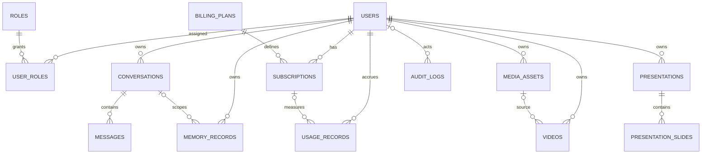

# NGIT PostgreSQL ERD

Database objects are isolated in the `ngit` schema. IDs are UUIDs and timestamps are `timestamptz`. PostgreSQL is the system of record; owned records carry `user_id`.

## Isolation and ownership
Composite foreign keys ensure messages/memory share their conversation owner, slides share their presentation owner, video assets share their owner, and usage records share their subscription owner. RLS is enabled and forced for all user-owned tables. In each transaction, set `ngit.user_id` from authenticated server context; never accept it from a client. Use a constrained application database role (not superuser or table owner). RLS policies fail closed when no context is set.

## Migrations and seeds
Apply `0001_initial_schema.sql`, then `0002_seed_reference_data.sql`, using an empty database for initialization. The migration ledger records applied versions. Seeds are conflict-safe. Money is currency plus integer minor units. Provider credentials are not stored; `credential_ref` is only a secret-management reference, and provider integrations remain optional and disabled by default.

Run the SQL integration test on a disposable database with `DATABASE_URL=... sh services/api/db/tests/run.sh`. It exercises relational ownership, RLS reads and writes, and seed presence, then rolls back test data. The test script invokes psql; test execution requires PostgreSQL and was not run in the authoring environment.

## Indexes
Indexes support user-scoped chronological lists, conversation message order, memory owner/type retrieval, subscription and usage periods, media/presentation recency, ordered slides, enabled provider lookup, role reverse lookup, and audit timelines. JSON metadata is not indexed until real query patterns justify specific GIN/expression indexes.
