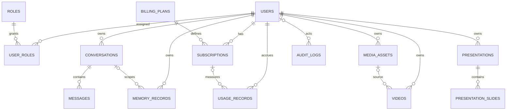

# NGIT PostgreSQL ERD

The database is isolated in the `ngit` schema. UUIDs identify domain records; timestamps are `timestamptz` in UTC. The database is authoritative for ownership and constraints.

## Ownership and isolation

Every user-owned record carries `user_id`. Composite foreign keys tie messages and memory to a conversation with the same owner, slides to a presentation with the same owner, video assets to their owner, and usage to a subscription belonging to the same user. RLS is enabled and forced on all user-owned tables; set transaction-local `ngit.user_id` from authenticated server context before querying. Never accept it from client-supplied ownership claims. Database owners/superusers can bypass RLS by PostgreSQL design; the application connection must use a constrained role and must not be a superuser or table owner.

## Migration and seed order

Apply `services/api/db/migrations/0001_initial_schema.sql` then `0002_seed_reference_data.sql`. Seeds are idempotent. The schema uses PostgreSQL-native `pgcrypto`; money is stored as currency plus integer minor units. Provider credential values are deliberately not stored here: `credential_ref` is only a reference into a future secret-management interface, and provider integrations are optional and disabled by default.

Run the disposable-database checks with `DATABASE_URL=... sh services/api/db/tests/run.sh`. The SQL test validates relational ownership, row-level read/write isolation, and reference seeds, then rolls back its test records.

## Index strategy

Indexes cover user-scoped chronological listings, conversation message order, memory lookup by owner/type, subscription/usage periods, media and presentation recency, ordered slides, provider enabled lookup, role reverse lookup, and audit actor/resource/action timelines. JSON metadata remains unindexed until query patterns justify targeted expression or GIN indexes.
