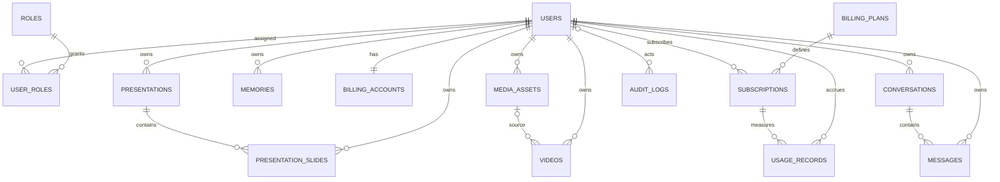

# NGIT PostgreSQL ERD

All application domain tables reside in isolated schema `ngit`. Identifiers are UUID; timestamps use `timestamptz`. Composite foreign keys include `user_id` where a child must belong to the same tenant as its parent.

`provider_configs` contains optional global provider metadata and opaque credential references only; it is disabled by default and never requires an external AI API. `schema_migrations` tracks applied SQL. `audit_logs` and provider configuration are privileged service data, not tenant-facing RLS records.

RLS is enabled and forced on user-scoped tables. Trusted API transactions set `ngit.user_id` from authenticated server context. Use a non-owner, non-superuser role without `BYPASSRLS`; table owners and superusers can bypass policy behavior. Composite owner FKs additionally prevent cross-user message/conversation, video/source-asset and slide/presentation links. Indexes serve owner-scoped recent lists, chronological message fetches, joins and audit timelines.

Apply migrations and run disposable-database checks per `services/api/db/README.md`. The presence of SQL checks does not mean they have executed.
