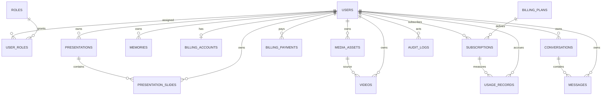

# NGIT PostgreSQL ERD

All application objects are isolated in schema `ngit`. UUID keys and
`timestamptz` timestamps are used throughout. Tenant-owned records carry
`user_id`; composite foreign keys prevent child rows from referencing a
parent belonging to another tenant. Forced row-level security applies to
user-owned tables; trusted server code sets `ngit.user_id` from authenticated
caller context. Use a non-owner, non-superuser role without `BYPASSRLS`.

`provider_configs` holds optional global provider metadata and opaque
`credential_ref` values only; secret material must live in an approved
server-side secret manager. `billing_webhook_events` is privileged provider
processing data and denies tenant access. `schema_migrations` records applied
versions. `admin_rules` and `service_controls` are protected administrative
state. Indexes support owner-scoped recent lists, conversation chronology,
role joins, billing lookups, provider availability and audit timelines.

See `services/api/db/migrations/` for the authoritative ordered SQL. Apply on a
fresh disposable PostgreSQL instance and run `services/api/db/tests/`; checked-in
SQL is not execution evidence.
