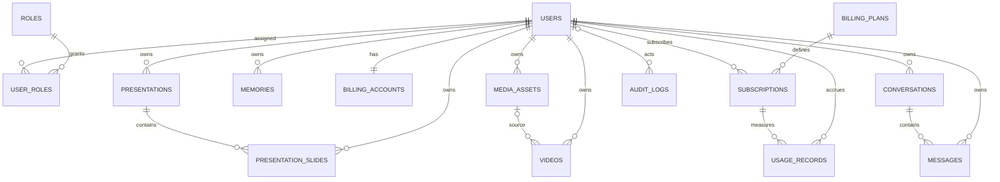

# NGIT PostgreSQL ERD

Application domain tables are isolated in schema `ngit`. Identifiers are UUID and timestamps are `timestamptz`. Child/parent composite keys include tenant ownership where appropriate.

`provider_configs` is optional global metadata, stores opaque credential references only, defaults disabled, and never makes external AI mandatory. `schema_migrations` records applied SQL. Audit logs, roles and reference/provider configuration are privileged service data and are not end-user-readable.

Forced RLS protects user-scoped records. Trusted API code sets `ngit.user_id` transaction-locally from authenticated server context. The app role must not own tables, be superuser, or have `BYPASSRLS`. Composite foreign keys prevent cross-user conversation/message, media/video and presentation/slide links. Indexes support owner-scoped recent lists, chronological messages, joins, provider lookup and audit timelines.

Apply migrations and execute disposable-database assertions per `services/api/db/README.md`; checked-in tests do not imply they ran.
